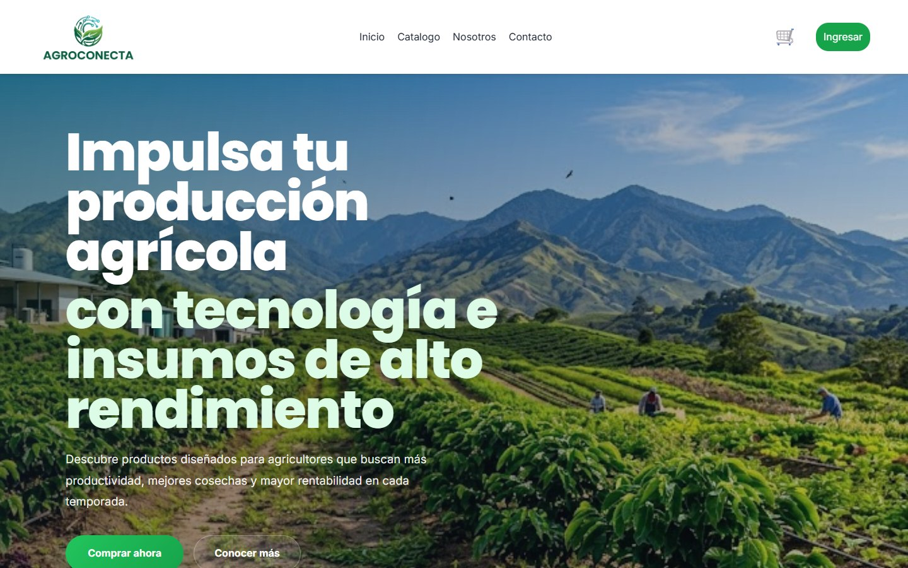
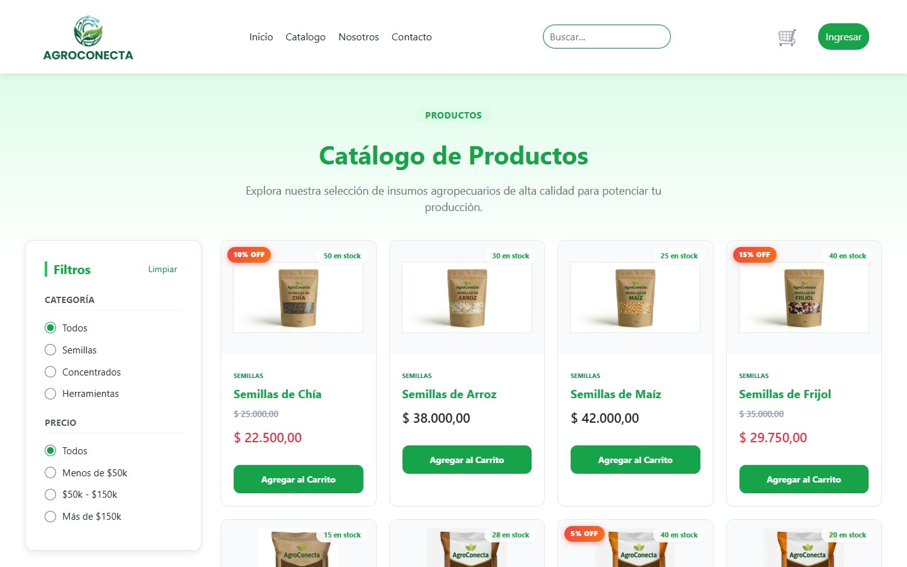
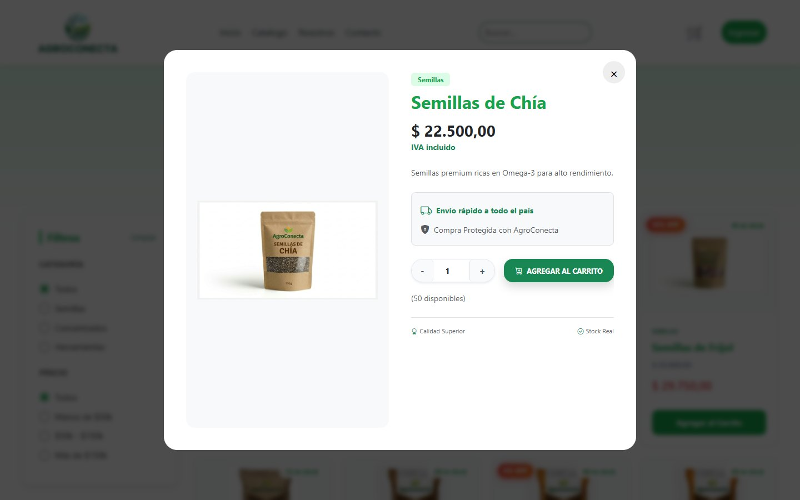
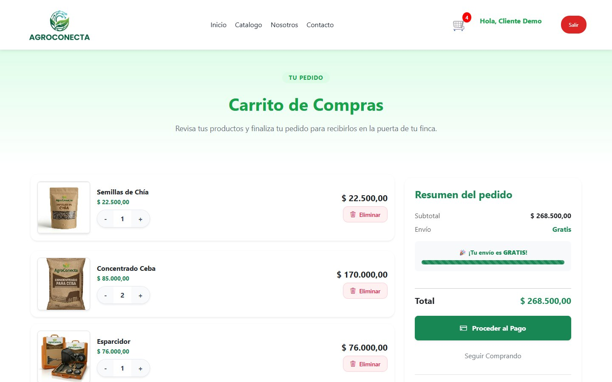
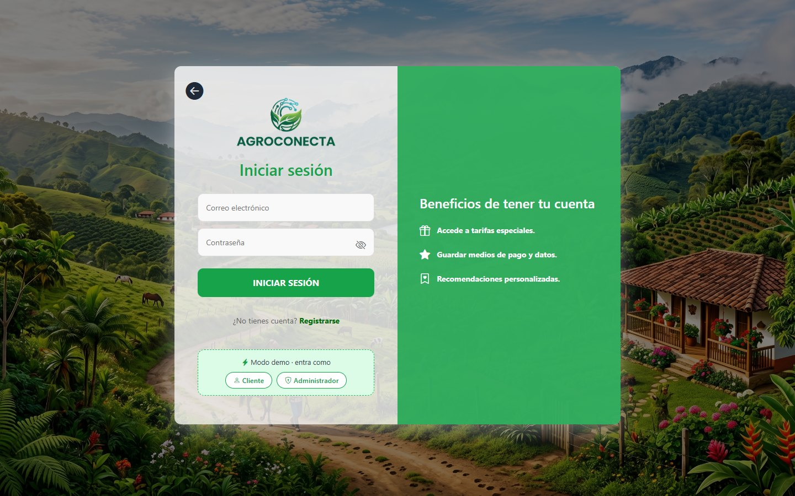
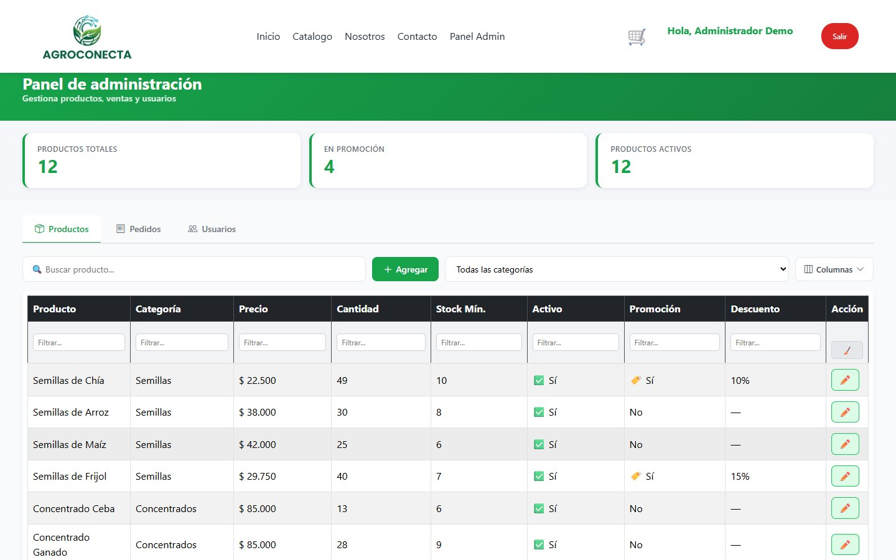
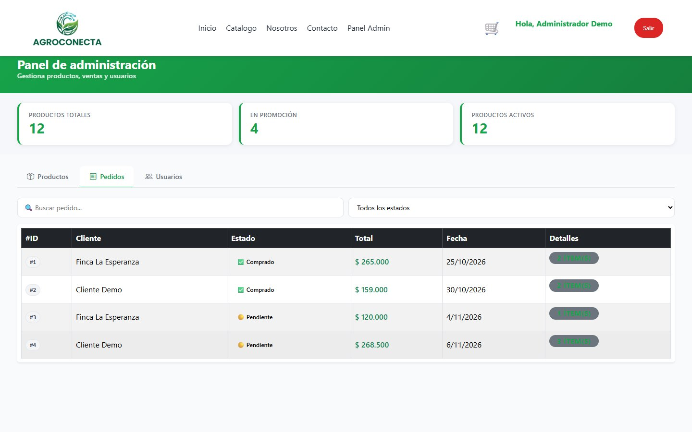
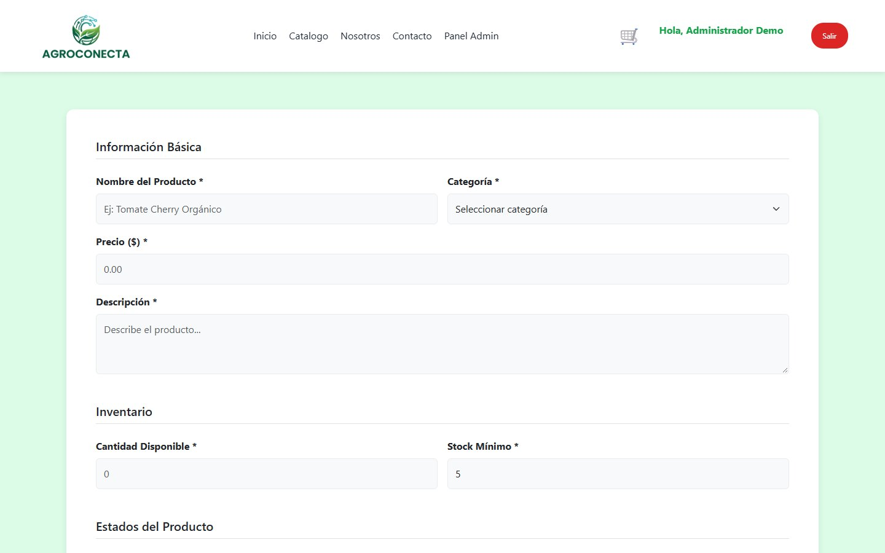
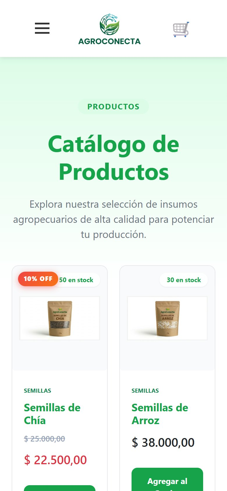

# AgroConecta 🌾

Plataforma de e-commerce para conectar insumos del campo (semillas, concentrados y herramientas) con productores y consumidores finales. Es una **SPA construida a mano con JavaScript vanilla**, con router propio, consumo de una API REST en Spring Boot con JWT y panel de administración por roles.

**▶ Demo en vivo:** https://cesarespa.github.io/AgroConecta/



## ✨ Funcionalidades

| Cliente | Administrador |
|---|---|
| Catálogo con filtros por categoría y precio, y buscador sin tildes | Panel con métricas de productos, promociones y activos |
| Detalle de producto, descuentos y stock en tiempo real | Tabla de productos con columnas configurables y filtros por tipo de dato |
| Carrito persistente con envío gratis desde $150.000 | Edición de precio, stock, estado y promociones |
| Registro con validaciones (teléfono, email, fuerza de contraseña) | Alta de productos con imágenes Base64 y editor de texto enriquecido |
| Checkout que crea el pedido y descuenta stock | Gestión de pedidos (historial de estados) y usuarios |

Además, las rutas de administración están protegidas por rol: un cliente no puede entrar al panel, y un administrador no puede comprar.

## 🔌 API real + modo demo de respaldo

La tienda funciona en **modo `auto`**:

1. Usa la **API real** ([CesarEspa/Api-AgroConecta](https://github.com/CesarEspa/Api-AgroConecta)): Spring Boot en **Render** y PostgreSQL en **Supabase**. La etiqueta de abajo a la izquierda dice **Conectado a la API**.
2. Si el servidor no responde en 8 s (el plan gratis de Render se apaga tras 15 min sin uso y tarda 1-2 min en despertar), la visita sigue en **modo demo**: `js/services/mockApi.js` simula todos los endpoints de `/api/v1` con datos en `localStorage`. Al mismo tiempo se envía una petición para despertar el servidor, así la siguiente visita ya usa la API.

En la pantalla de **Ingresar** hay un botón para entrar como **cliente de prueba**. En modo demo también aparece **Administrador**, y la etiqueta **Modo demo** permite reiniciar los datos.

Configuración en `js/services/api.js`:

```js
const API_BASE_PROD = 'https://api-agroconecta-7gyk.onrender.com/api/v1';
const API_MODE = 'auto';   // 'demo' | 'api' | 'auto'
```

También se puede forzar desde la URL: `?modo=api` o `?modo=demo`. En local: `?modo=api&api=http://localhost:8080/api/v1`.

## 📸 Capturas

| Catálogo | Detalle de producto |
|---|---|
|  |  |
| **Carrito** | **Ingreso con accesos demo** |
|  |  |
| **Panel · productos** | **Panel · pedidos** |
|  |  |
| **Nuevo producto** | **Móvil** |
|  |  |

## 🛠️ Tecnologías

- **Frontend:** HTML5, CSS3, JavaScript ES Modules, Bootstrap 5, Bootstrap Icons.
- **Arquitectura:** SPA con hash router propio, vistas como funciones que devuelven HTML, CSS por vista cargado dinámicamente y servicio de API centralizado.
- **Backend (repositorio aparte):** Java 17, Spring Boot 3, Spring Security + JWT, JPA, PostgreSQL y OpenAPI ([CesarEspa/Api-AgroConecta](https://github.com/CesarEspa/Api-AgroConecta)).

## 📁 Estructura

```
index.html              # Shell de la SPA (#root)
js/
  main.js               # Layout, header, menú móvil, logout, indicador demo
  router.js             # Rutas, protección por rol y CSS por vista
  components/           # header.js, footer.js
  views/                # home, catalogo, carrito, sesion, panel, addProductos, nosotros, contacto
  services/
    api.js              # Cliente HTTP (JWT, errores, modo demo/api/auto)
    mockApi.js          # Backend simulado para la demo
data/products.js        # Productos semilla
styles/                 # Variables y estilos por vista
database/               # Script SQL y diagrama entidad-relación
Docs/                   # Términos y condiciones y capturas
```

## ▶️ Ejecutar en local

No requiere instalación. Sirve la carpeta con cualquier servidor estático (los módulos ES no funcionan con `file://`):

```bash
python -m http.server 5520
```

Luego abre http://localhost:5520

## 👥 Equipo

Proyecto final del bootcamp **Generation Colombia (Java Full Stack)**.

- **Cesar España**
- **Ivan Chavez**
- **Juan Castro**
- **Daniel Vega**

Repositorio original del equipo: [DanielVega825/AgroConecta-t8-SPAs](https://github.com/DanielVega825/AgroConecta-t8-SPAs)

## ✅ Notas de mejora resueltas

- [x] Un administrador no puede pagar: al intentarlo se muestra un aviso.
- [x] Botón **Salir** compacto cuando hay sesión.
- [x] Los clientes no pueden entrar a las vistas de administración.
- [x] Selector de columnas y filtros por tipo de dato en el panel.
- [x] `descripcionLong` con editor enriquecido (negrita, listas, enlaces, alineación).
- [x] Buscador del header y enlaces de categoría del footer conectados al catálogo.
- [x] Menú móvil funcional después de iniciar o cerrar sesión.
- [x] Pantalla de ingreso sin desbordes en móvil.
- [x] Cerrar sesión ya no borra el carrito ni los datos de la demo.

### Pendiente

- [x] Backend desplegado en Render + Supabase y tienda en modo `auto`.
- [ ] Plan pago o *keep-alive* si se quiere evitar el arranque en frío de Render.
- [ ] Sanitizar en el backend el HTML de `descripcionLong` antes de guardarlo.
